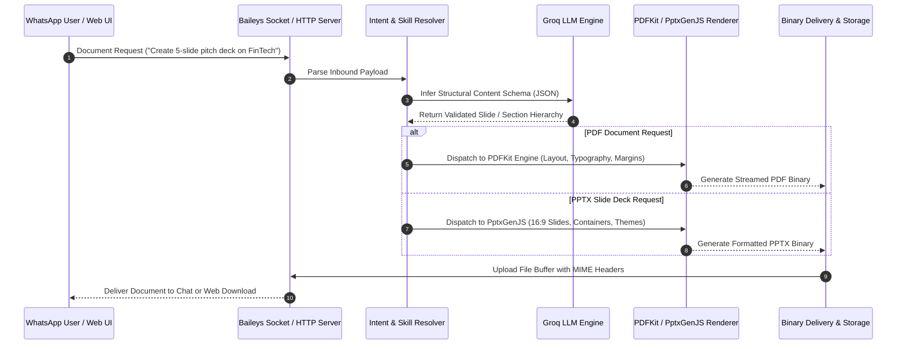

<div align="center">
  <h1>whatsapp-docgen-bot</h1>
  <p>WhatsApp AI document and slide deck generation bot with companion web UI, powered by Baileys and Groq LLM.</p>

  <p>
    <a href="https://github.com/itsgoharrehman/whatsapp-docgen-bot/releases"></a>
    <a href="LICENSE"></a>
    
    
    
    <a href="https://github.com/itsgoharrehman/whatsapp-docgen-bot/stargazers"></a>
    <a href="https://github.com/itsgoharrehman/whatsapp-docgen-bot/issues"></a>
  </p>
</div>

---

## Overview

whatsapp-docgen-bot is an autonomous document and visual slide deck generation engine accessible through WhatsApp chats or its companion web UI. Powered by `@whiskeysockets/baileys` and Groq LLM inference, the bot processes conversational prompts, extracts structured document layouts, and renders publication-ready PDF reports and 16:9 widescreen PowerPoint presentation decks (`.pptx`) on demand.

The companion web dashboard provides direct administrative oversight, real-time generation previews, and queue inspection.

## Architecture and Rendering Pipeline



## Core Capabilities

### 1. Presentation Deck Generation (`src/skills/pptx/`)
* Generates 16:9 widescreen presentation slide decks directly from conversational outlines.
* Formats cover slides, executive summaries, multi-column feature comparisons, key metrics, and concluding timelines.
* Produces native PowerPoint `.pptx` binaries editable in Microsoft PowerPoint, Google Slides, and Apple Keynote.

### 2. Publication-Grade PDF Generation (`src/skills/pdf/`)
* Renders structured business reports, technical whitepapers, invoices, and cheat sheets.
* Implements dynamic header/footer pagination, table generation, and clean typography layouts.

### 3. Dual Interface: WhatsApp & Web Companion
* **WhatsApp**: Send commands directly in private chats or tagged group threads (e.g., `/pdf topic` or `/pptx title`).
* **Web Panel**: Access the integrated frontend (`frontend/`) to visualize live document generation, preview color schemes, and inspect system logs.

## Prerequisites

* **Runtime**: Node.js 18.x or 20.x LTS.
* **AI Provider**: Groq Cloud API Key (`GROQ_API_KEY`).
* **WhatsApp Account**: Account linked via Baileys QR code.

## Installation and Quickstart

### 1. Clone the Repository

```bash
git clone https://github.com/itsgoharrehman/whatsapp-docgen-bot.git
cd whatsapp-docgen-bot
```

### 2. Install Dependencies

```bash
npm install
```

### 3. Configure Environment

Copy the example configuration:

```bash
cp .env.example .env
```

Edit `.env`:

```env
PORT=3000
NODE_ENV=production
GROQ_API_KEY=gsk_your_groq_api_key_here
ADMIN_NUMBER=923238522260
MAX_SLIDES_PER_DECK=20
```

### 4. Run the Service

```bash
node src/index.js
```

Scan the terminal QR code using WhatsApp to connect the daemon. Open `http://localhost:3000` to access the companion web panel.

## Configuration Reference

| Variable | Type | Default | Description |
| :--- | :--- | :--- | :--- |
| `PORT` | Number | `3000` | Port for the web companion UI and administrative server. |
| `GROQ_API_KEY` | String | Required | Groq Cloud API Key for structured document schema inference. |
| `ADMIN_NUMBER` | String | Required | WhatsApp phone number for administrative controls. |
| `MAX_SLIDES_PER_DECK` | Number | `20` | Hard limit on slides rendered per PPTX request. |
| `MAX_PDF_PAGES` | Number | `15` | Hard limit on pages rendered per PDF request. |

## Security Considerations

* **Memory Bounded Rendering**: Document rendering pipelines limit maximum buffer allocation to prevent out-of-memory (OOM) denial of service on large payloads.
* **Sandbox Execution**: Content inputs are strictly typed and parsed against schema validators before being processed by document renderers.
* **Session Protection**: WhatsApp multi-device authentication credentials in `auth_info_baileys/` are isolated and excluded from version control.

## License and Security Contact

This project is licensed under the [MIT License](LICENSE).

For responsible disclosure of security vulnerabilities, review [SECURITY.md](SECURITY.md) or contact `goharrehmanfsd260@gmail.com`.